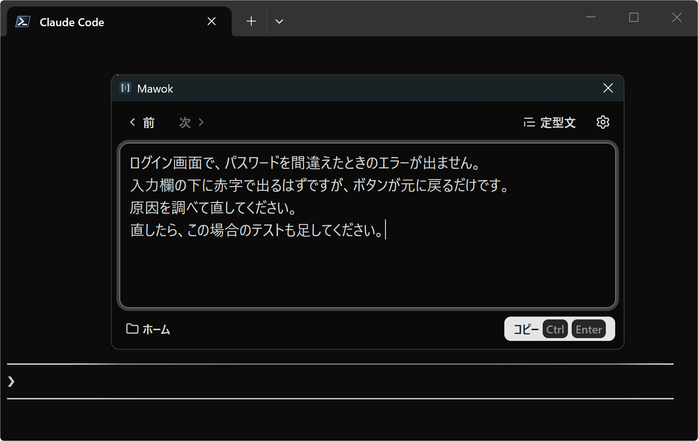
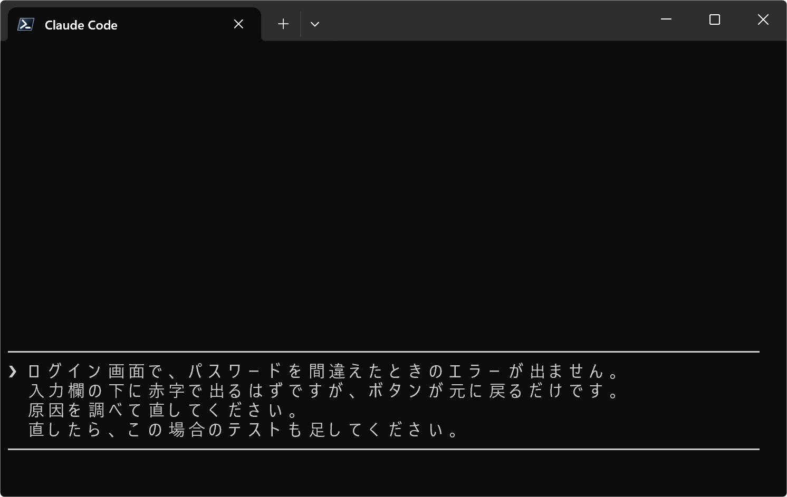
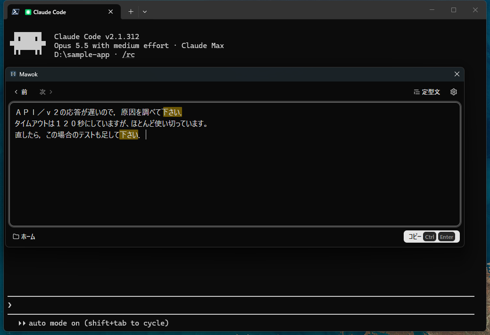
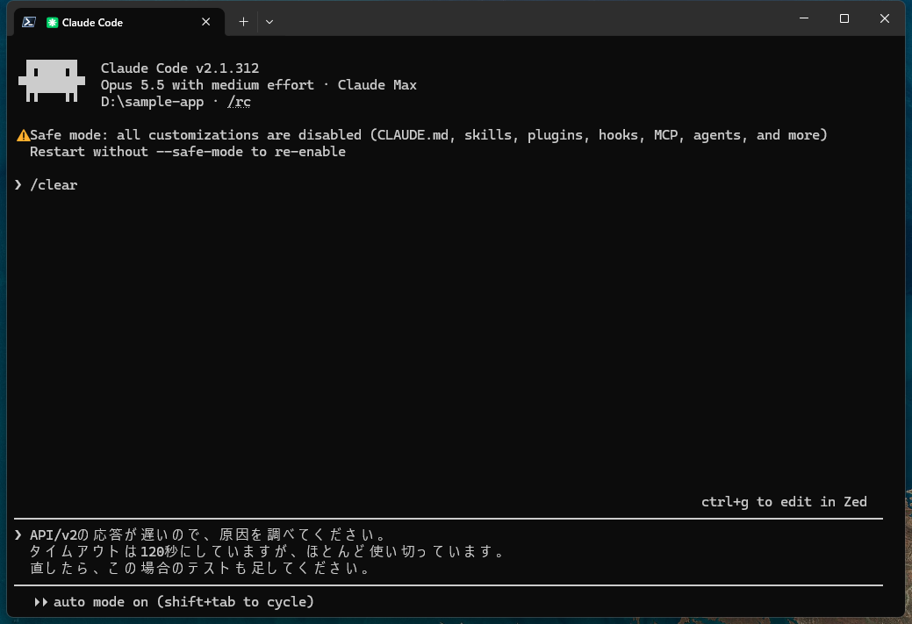

## 主な特徴

- **ホットキーで呼び出し**: 常駐しているので、使いたいときにホットキーですぐ呼び出せます。
- **テキストの整形**: コピーのときに、句読点や英数字の全角・半角を揃えたり、あらかじめ決めておいた語句を置き換えたりできます。
- **定型文**: よく使う文を登録しておき、呼び出すことができます。
- **履歴**: 前にコピーしたテキストを呼び戻せます。
- **クロスプラットフォーム**: Windows・Mac・Linux に対応しています。

## スクリーンショット

ホットキーを押すと、すぐにテキストウィンドウが出ます。

「コピー」ボタンまたはショートカットキーでコピーすると、ウィンドウが閉じて元のアプリに戻るので、そのまま貼り付けられます。

音声入力などで書いた文には、全角の英数字や「，．」が混ざることがあります。

コピーのときに、英数字を半角に、句読点を「、。」に揃え、決めておいた語句を置き換えられます。

## よくある質問

### 無料ですか？

無料で、すべての機能を使えます。アカウントの登録も要りません。

### デバイスの間で設定を揃えるには？

設定を置くフォルダーを、iCloud Drive・OneDrive・Dropbox など、デバイスの間で同期しているフォルダーの中に選びます。

### 書いたテキストが、どこかへ送られることは？

ありません。Mawok がインターネットとやり取りするのは、Mac 版の更新の確認だけです。

### 終了するには？

タスクトレイ（macOS ではメニューバー）のメニューから終了します。macOS では、Cmd+Q では終了しません。

## 動作環境

- **Windows**: Windows 10（64ビット）以上。
- **macOS**: macOS 13（Ventura）以上。
- **Linux**: 64ビット（x86-64）。デスクトップは、Ubuntu 24.04 以上の GNOME と、Hyprland に対応します。
