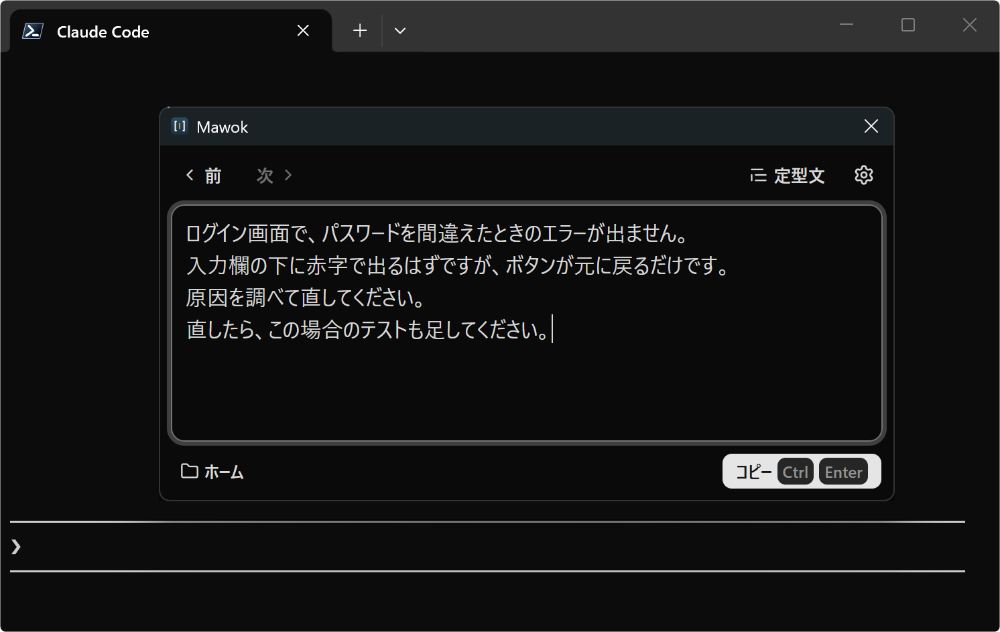
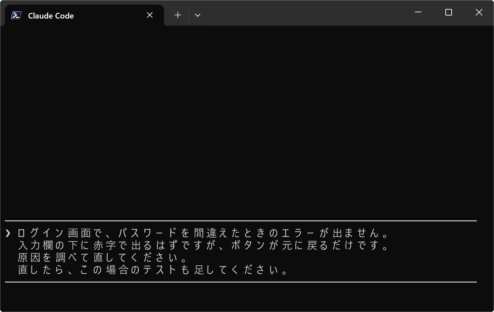
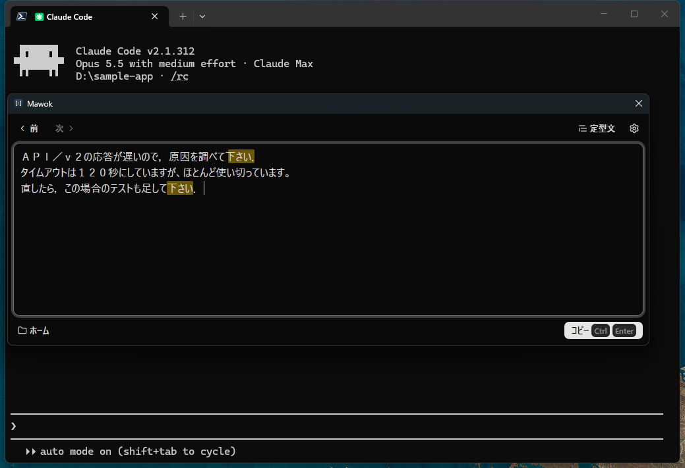
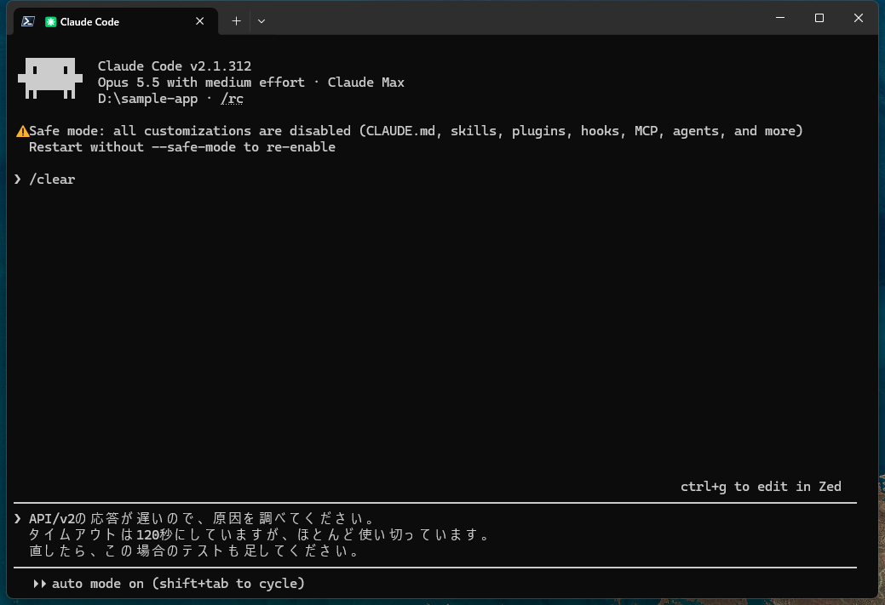
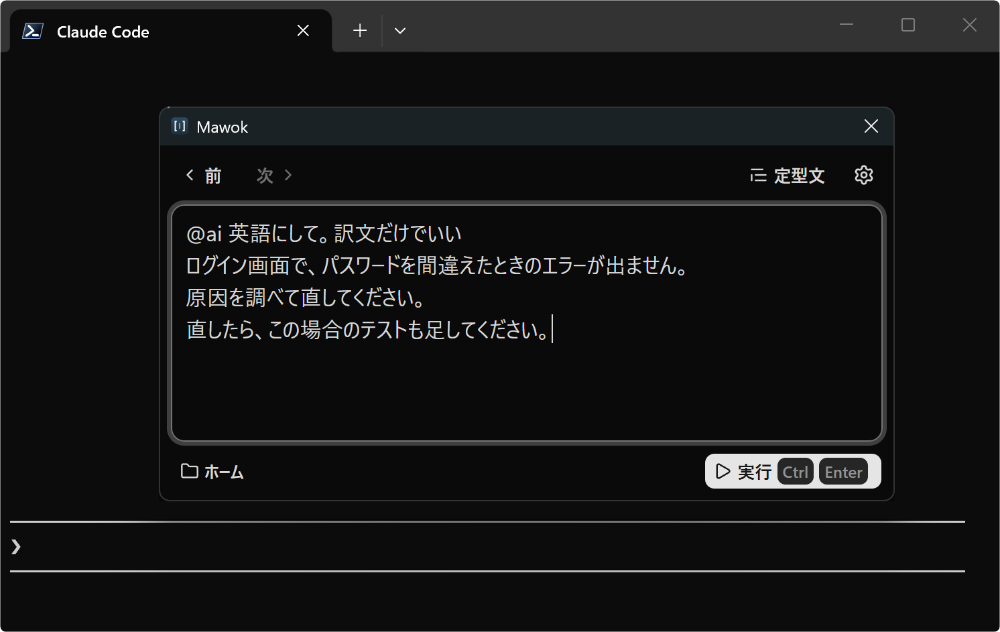
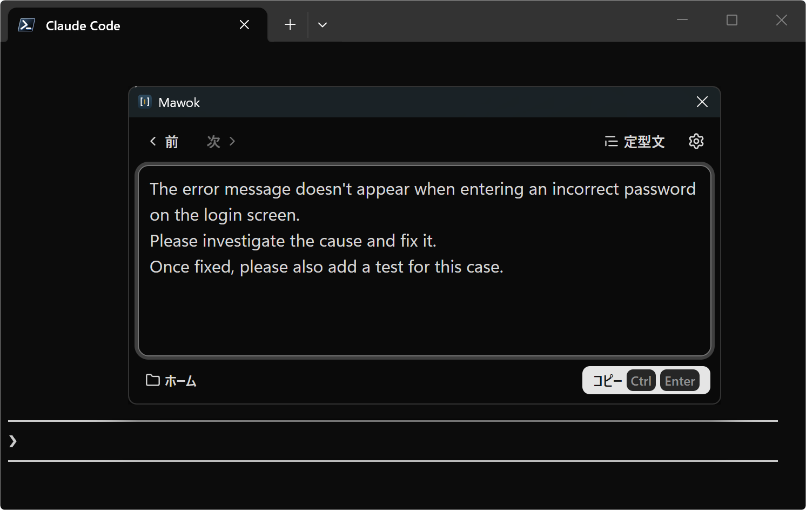

## 主な特徴

- **Enter では送られない**: テキストウィンドウでは Enter は改行です。書きかけのまま、どこかへ送られることはありません。
- **貼り付けるのは自分**: コピーすると元のアプリに戻るので、読み直してから自分で貼り付けます。
- **どのアプリでも同じ**: ホットキー一つで、ターミナルでもチャット欄でも、同じテキストウィンドウを出せます。
- **コピーのときに整える**: 句読点や全角・半角の統一と語句の置き換えを、コピーのたびに通せます。
- **AI やコマンドに通す**: 1行目に `@ai`・`@sh` と書くと、テキストを AI やコマンドに通して、結果で置き換えられます。
- **デバイスの間で揃える（Pro）**: 設定・定型文・置き換え辞書・履歴を、自分のデバイスの間で同期できます。

## 画面

ホットキーで、使っているアプリの上にテキストウィンドウが出ます。Enter は改行なので、何行でも落ち着いて書けます。

コピーすると元のアプリに戻るので、自分で貼り付けます。送るのは、読み直してからです。

書いたままの文には、全角の英数字や「，．」が混ざることがあります。

コピーのときに英数字の幅や句読点を揃え、決めておいた語句を置き換えられます。

1行目に `@ai` と頼みたいことを書いて、実行します。

AI の結果でテキストが置き換わるので、読んでからコピーできます。

## 使う流れ

1. ホットキーを押すと、テキストウィンドウが出ます。
2. 書きます。音声入力でも、キーボードでも構いません。
3. コピーのキー（既定は Ctrl+Enter / Cmd+Enter）を押します。
4. 元のアプリに戻っているので、そのまま貼り付けます。

## よくある質問

### 無料ですか？

Mawok は無料で使えます。設定と履歴をデバイスの間で同期するときは、Pro（月額 480 円・年額 4,800 円、税込み）が要ります。AI アクションは、自分の API キーか、Mawok のアカウントのクレジットで使えます。詳しくは[料金](/pricing/)をご覧ください。

### AI は必ず使いますか？

使いません。既定では使わない設定です。使うときは、AI サービスを「Mawok」（アカウントのクレジットで使う）か、自分の API キーで使う Gemini・Anthropic・OpenAI（OpenAI と互換のサービスを含む）から選びます。

### AI アクションのクレジットとは？

キーを持っていなくても AI アクションを使えるよう、Mawok が Google の Gemini に取り次ぐ分の前払いです。新しいアカウントには一度だけ、お試しのクレジット（買い足し1回分の半分）が付きます。期限はありません。買い足しは[料金](/pricing/)から行えます。

### 同期した設定や履歴は、運営者に読まれますか？

読まれません。同期の中身は、利用者が決める同期のパスワードで暗号化してから預かるので、運営者は中身を読めません。

### 終了するには？

タスクトレイ（macOS ではメニューバー）のメニューから終了します。macOS では、Cmd+Q では終了しません。

## 動作環境

- **Windows**: Windows 10（64ビット）以上。
- **macOS**: macOS 13（Ventura）以上。
- **Linux**: 64ビット（x86-64）。デスクトップは、Ubuntu 24.04 以上の GNOME と、Hyprland に対応します。
