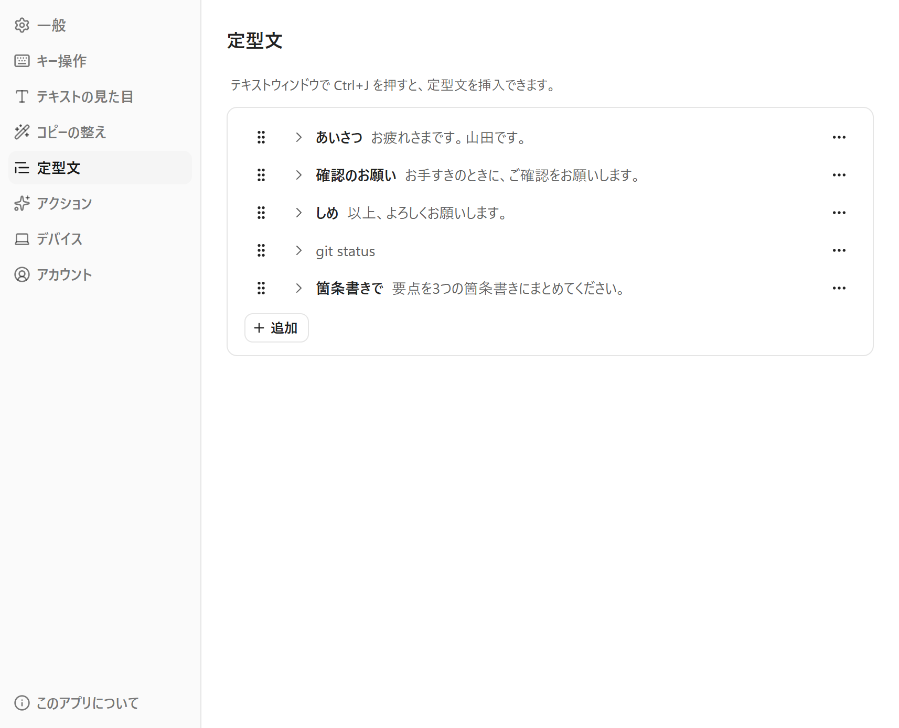
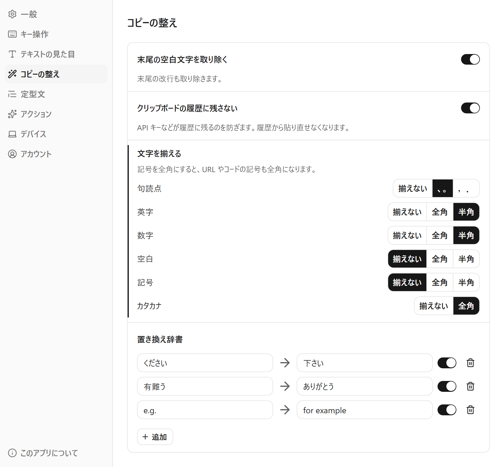

## 主な特徴

- **ひと押しで出る**: ホットキー一つで、どのアプリからでもテキストウィンドウを出せます。
- **貼り付けるのは自分**: コピーすると元のアプリに戻るので、そのまま貼り付けます。
- **コピーのときに整える**: 語句の置き換えや、句読点・全角と半角の統一を、コピーのたびに自動で通せます。
- **定型文**: よく使う書き出しや指示文を、選ぶだけで挿入できます。
- **AI やコマンドに通す**: 1行目に `@ai`・`@sh` と書いて出すと、テキストを AI やコマンドに通して、結果で置き換えられます。
- **書いたものを呼び戻せる**: 前にコピーしたテキストを、キーでたどれます。
- **デバイスの間で揃える（Pro）**: 設定・定型文・置き換え辞書・履歴を、自分の Windows と Mac の間で同期できます。

## 画面

よく使う文と、AI やコマンドに通す指示は、設定の「定型文」に登録しておき、テキストウィンドウで選んで使います。最初から、AI に頼む「校正」（`@ai`）と、行を並べ替える「行を並べ替え」（`@sh sort`）が入っています。AI に頼むとき（AI アクション）は、設定の「AI」で、AI サービスに「Mawok」（アカウントのクレジット）か、自分の API キーで使う Gemini・Anthropic・OpenAI を選ぶと使えます。

コピーのたびに通す整えも、設定で選べます。

## 使う流れ

1. ホットキーを押すと、テキストウィンドウが出ます。
2. 書きます。音声入力でも、キーボードでも構いません。
3. コピーのキー（既定は Ctrl+Enter / Cmd+Enter）を押します。
4. 元のアプリに戻っているので、そのまま貼り付けます。

## よくある質問

### 無料ですか？

Mawok は無料で使えます。設定と履歴をデバイスの間で同期するときは、Pro（月額 480 円・年額 4,800 円、税込み）が要ります。AI アクションは、自分の API キーか、Mawok のアカウントのクレジットで使えます。詳しくは[料金](/pricing/)をご覧ください。

### AI は必ず使いますか？

使いません。既定では使わない設定です。使うときは、AI サービスを「Mawok」（アカウントのクレジットで使う）か、自分の API キーで使う Gemini・Anthropic・OpenAI（OpenAI と互換のサービスを含む）から選びます。

### AI アクションのクレジットとは？

キーを持っていなくても AI アクションを使えるよう、Mawok が Google の Gemini に取り次ぐ分の前払いです。新しいアカウントには一度だけ、お試しのクレジット（買い足し1回分の半分）が付きます。期限はありません。買い足しは[料金](/pricing/)から行えます。

### 同期した設定や履歴は、運営者に読まれますか？

読まれません。同期の中身は、利用者が決める同期のパスワードで暗号化してから預かるので、運営者は中身を読めません。

### 終了するには？

タスクトレイ（macOS ではメニューバー）のメニューから終了します。macOS では、Cmd+Q では終了しません。

## 動作環境

- **Windows**: Windows 10（64ビット）以上。
- **macOS**: macOS 13（Ventura）以上。Apple シリコンの Mac に限ります。
