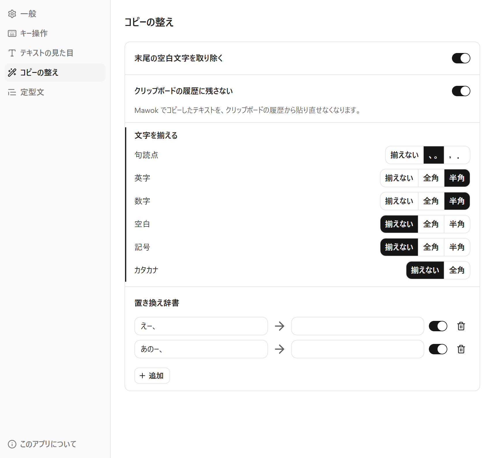
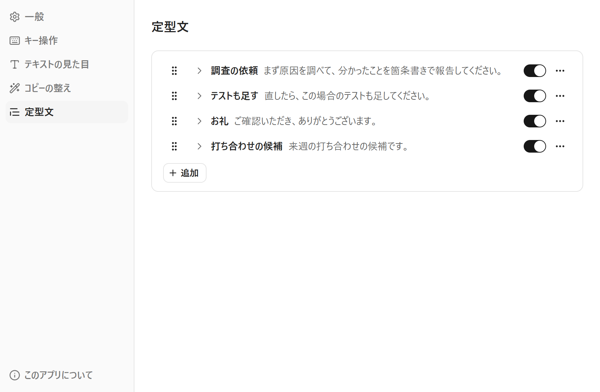
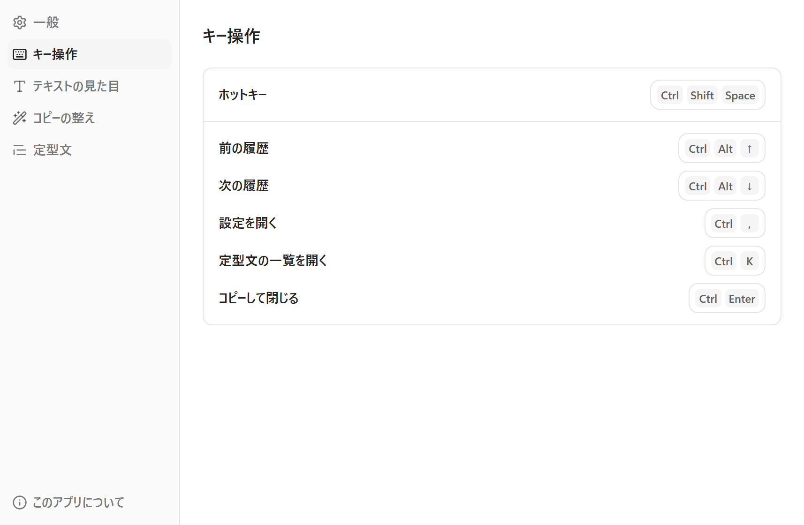

## 主な特徴

- **ホットキーで呼び出し**: 常駐しているので、使いたいときにホットキーですぐ呼び出せます。
- **テキストの整形**: コピーのときに、句読点や英数字の全角・半角を揃えたり、あらかじめ決めておいた語句を置き換えたりできます。
- **定型文**: よく使う文を登録しておき、呼び出すことができます。
- **履歴**: 前にコピーしたテキストを呼び戻せます。
- **クロスプラットフォーム**: Windows・Mac・Linux に対応しています。

## 紹介動画

ホットキーでテキストウィンドウを出して書き、コピーすると、ウィンドウが閉じて元のアプリに戻ります。あとは Ctrl+V などで貼り付けます。

<video src="/flow.mp4" autoplay loop muted playsinline width="1492" height="720" aria-label="チャットの画面でホットキーを押すとテキストウィンドウが出て、「来週の打ち合わせの案内を、丁寧なメールの文にしてください。」と書く。コピーするとウィンドウが閉じ、チャットの入力欄に同じ文が貼り付けられる（まだ送っていない）" style="max-width:100%;height:auto"></video>

音声入力などで書いた文に混ざる全角の英数字や「，．」、「えー」のような言葉も、コピーのときに揃えたり取り除いたりできます。

<video src="/cleanup.mp4" autoplay loop muted playsinline width="1492" height="720" aria-label="テキストウィンドウに「えー、来週のＭＴＧは１０時からで，あのー、資料はＡ４で３部お願いします．」が入り、「えー、」と「あのー、」に色が付いている。コピーしてチャットの入力欄に貼り付けると「来週のMTGは10時からで、資料はA4で3部お願いします。」になっている" style="max-width:100%;height:auto"></video>

## スクリーンショット

「コピーの整え」で、コピーのときに揃える文字の種類と、置き換える語句を決められます。

「定型文」に、よく使う文を登録しておけます。テキストウィンドウの「定型文」のボタンかショートカットキーで一覧を出し、選んで挿入します。

ホットキーと、テキストウィンドウの中のキー操作は、「キー操作」で変えられます。前にコピーしたテキストも、キー操作で呼び戻せます。

## よくある質問

### 無料ですか？

無料で、すべての機能を使えます。アカウントの登録も要りません。

### 書いたテキストが、どこかへ送られることは？

ありません。Mawok がインターネットとやり取りするのは、Mac 版の更新の確認だけです。

### 終了するには？

タスクトレイ（macOS ではメニューバー）のメニューから終了します。macOS では、Cmd+Q では終了しません。

## 動作環境

- **Windows**: Windows 10（64ビット）以上。
- **macOS**: macOS 13（Ventura）以上。
- **Linux**: 64ビット（x86-64）。デスクトップは、Ubuntu 24.04 以上の GNOME と、Hyprland に対応します。
